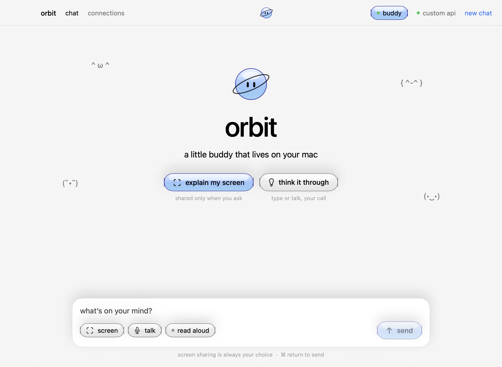
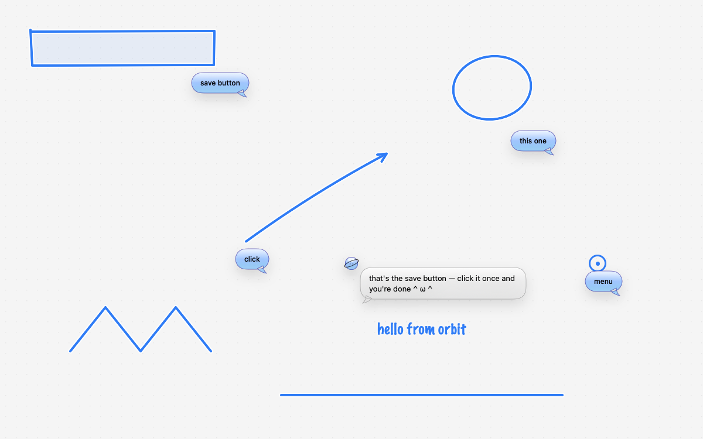
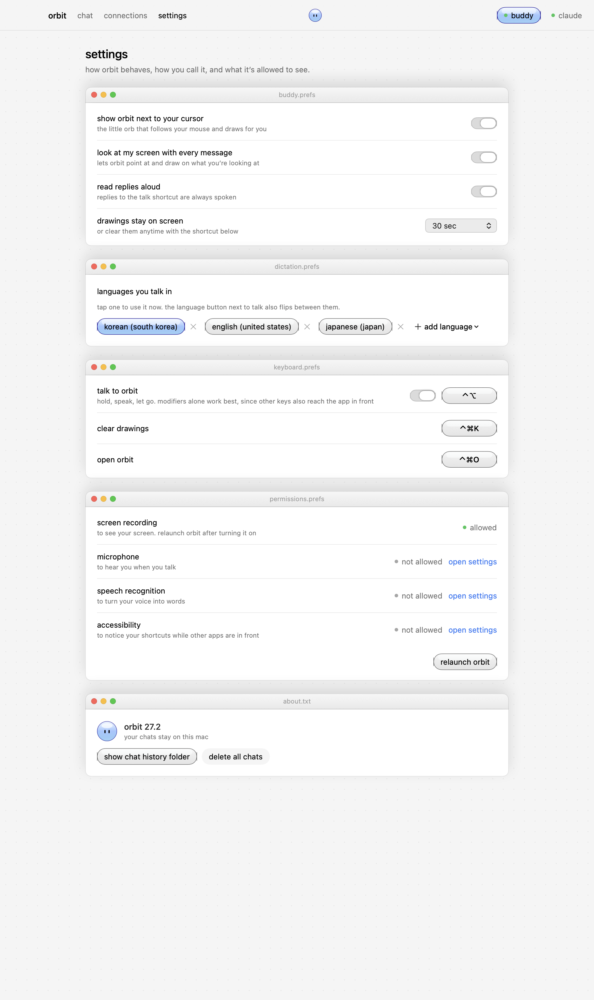
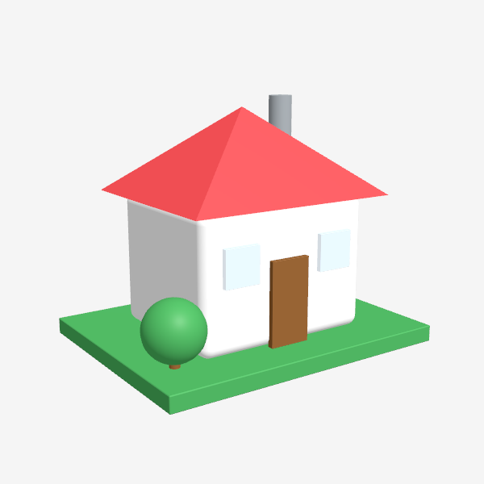

# orbit

a little buddy that lives on your mac.

Orbit sits next to your cursor. Hold **⌃ control + ⌥ option** anywhere and ask a question out loud. When you let go, Orbit looks at your screen, answers out loud, and draws on top of whatever you're using: it highlights buttons, circles things, draws arrows, and sketches in a notes app.






## What it does
- **Cursor buddy**: a small orb follows your mouse across every screen.
- **Push to talk**: hold ⌃⌥, speak, then let go. Speech is recognized on device when your Mac supports it.
- **Sees your screen**: each message includes a screenshot of the display under your cursor. You can turn this off with "sees screen".
- **Points and draws**: replies can include drawing tags (`POINT`, `BOX`, `CIRCLE`, `ARROW`, `LINE`, `PATH`, `TEXT`). Orbit animates them over your screen as if drawn with a pen.
- **Builds 3D models**: ask for something in 3D and Orbit builds a small model next to your cursor from simple shapes (`MODEL` and `PART` tags), one piece at a time, then slowly turns it. Rendered natively with SceneKit.
- **Chats**: past conversations are listed in a sidebar, like other AI apps.
- **Type from anywhere**: press ⌃⌘T in any app and a small box opens next to your cursor. Type, press return, and Orbit answers in its bubble and draws.
- **Settings**: buddy behavior, how long drawings stay, dictation languages, keyboard shortcuts, and permission status.
- **Custom shortcuts**: change the talk shortcut (modifiers alone or modifiers + key), "type to orbit" (default ⌃⌘T), "clear drawings" (default ⌃⌘K), and "open orbit" (default ⌃⌘O).
- **Many languages**: choose several dictation languages and flip between them with the language button next to talk, or pick **auto**. Auto listens in up to three of your languages at once and keeps the one you actually spoke.
- **Your choice of AI**: your ChatGPT (Codex CLI) or Claude (Claude Code) subscription, any OpenAI-compatible API, or a local Ollama model.
- **Model list**: Orbit asks each connection which models it offers (`codex debug models`, the API's `/models`, Ollama's installed models) and lists them in Connections and next to the composer. Claude Code has no list command, so Orbit shows its aliases (fable, opus, sonnet, haiku).

## Build
Requires macOS 14.2+ and Swift 5.10+.

```bash
cd app
./scripts/build.sh
open dist/Orbit.app
```

`build.sh` signs with your Apple Development certificate when you have one, so macOS keeps Orbit's permissions across rebuilds. An ad-hoc signature changes on every build, and macOS then quietly drops those permissions.

On first use, macOS asks for Screen Recording, Microphone, and Speech Recognition permissions. The ⌃⌥ hotkey also needs Accessibility permission, which you grant from the "allow the hotkey" link in the app.

If System Settings shows Orbit turned on but Orbit still says "not allowed", the saved entry belongs to an older build. Use **reset & ask again** in Settings → permissions, turn Orbit on in the list that opens, then relaunch Orbit.

## Design
See [app/DESIGN.md](app/DESIGN.md) for the design system.

## Credits
Inspired by [Clicky](https://github.com/farzaa/clicky) by Farza (MIT). Orbit is an independent app and is not affiliated with HeyClicky.
